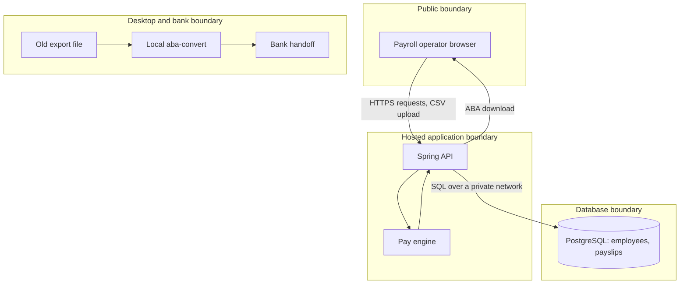

English | [简体中文](threat-model.zh-CN.md)

# Payslate Online threat model

This model covers the hosted payroll service: the Spring API, its PostgreSQL store, the pay engine, the ABA
export, and the inherited desktop converter that still prepares bank files. All data in this repository is
synthetic. Tax file numbers are a planned field and are not stored yet; the store does hold BSB and account
numbers, hourly rates, and the gross, tax and net figures on each payslip.

| Element / boundary | STRIDE concern | Sensitive data and consequence | Mitigation and status |
| --- | --- | --- | --- |
| Browser to API | Spoofing, tampering, repudiation | A caller could act as another operator or deny an action | OIDC bearer authentication and officer/employee role checks present and verified; request audit trail open |
| Search text to SQL | Tampering, information disclosure | Injection could reveal other employees' pay rates | Parameter binding fixed; a PostgreSQL regression test and the SpotBugs and Semgrep gates verify it |
| CSV upload to API | Denial of service, tampering | A malformed or oversized file could exhaust resources | Format parser present; size limits and bounded streaming open |
| API to PostgreSQL | Information disclosure, elevation of privilege | A query could cross employer boundaries | Private connectivity and employer-scoped queries verified; least privilege and encryption at rest open |
| API to pay engine to payslip | Tampering, repudiation | A wrong figure could reach an approved payslip | Engine characterization and state tests present; an immutable approval record open |
| API to operator ABA download | Information disclosure, tampering | Another employer's bank file could be downloaded | Paid-state and employer-scoped authorization present; download audit open |
| Old export to aba-convert | Tampering, denial of service | A crafted file could corrupt memory in the local converter | Robustness review done: a stack buffer overflow in the account-name copy and an integer overflow in the batch total reproduced under ASan/UBSan; a bounded name copy and a checked batch total are open |
| Local ABA to bank handoff | Spoofing, tampering | An altered file could reach the bank | File-format checks partial; authenticated transfer and reconciliation open |

STRIDE stands for spoofing, tampering, repudiation, information disclosure, denial of service and elevation of
privilege. A finding from static analysis marks a risk to review, not a proven exploit chain. Today the API
validates OIDC tokens and scopes every database query by employer; the items marked open are tracked for later
work.
