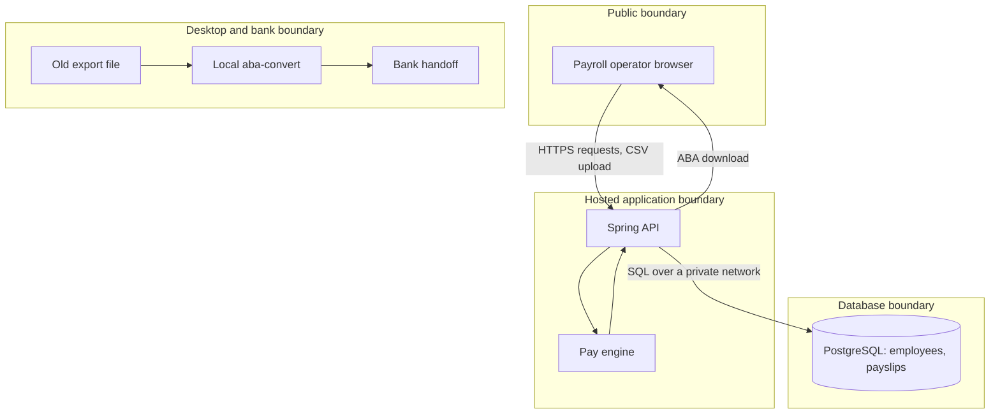

English | [简体中文](threat-model.zh-CN.md)

# Payslate Online threat model

This model covers the hosted payroll service: the Spring API, its PostgreSQL store, the pay engine, the ABA
export, and the inherited desktop converter that still prepares bank files. All data in this repository is
synthetic. Tax file numbers are a planned field and are not stored yet; the store does hold BSB and account
numbers, hourly rates, and the gross, tax and net figures on each payslip.

| Element / boundary | STRIDE concern | Sensitive data and consequence | Mitigation and status |
| --- | --- | --- | --- |
| Browser to API | Spoofing, tampering, repudiation | A caller could act as another operator or deny an action | OIDC bearer authentication and officer/employee role checks present and verified; denied requests (401/403 and record-not-found 404) logged as security events and counted on the dashboard; a full audit of successful reads and changes is still open |
| Search text to SQL | Tampering, information disclosure | Injection could reveal other employees' pay rates | Parameter binding fixed; a PostgreSQL regression test and the SpotBugs and Semgrep gates verify it |
| CSV upload to API | Denial of service, tampering | A malformed or oversized file could exhaust resources | [ADR 0012](../adr/0012-timesheet-upload-limits.md) limits: strict UTF-8, 1 MB per file and multipart request, 10 000 data rows, years 2000–2099, and trimmed employee names of 1–100 characters without controls (including tab); linear streaming parsing, line-numbered 400s, generic 500 problems and JUnit regression tests present; verified by campaign replay (seed `20260717`, 1 500 candidates, no findings) |
| CSV uploads for the same employee | Tampering | Duplicate uploads or overlapping shifts can cause duplicate pay; uploading the same file twice pays its shifts twice | Overlapping and duplicate shifts for an employee are now rejected on upload: within a file 400, against stored shifts 409, each naming the offending line; concurrent duplicate uploads are serialised by an employee row lock (see [ADR 0013](../adr/0013-reject-overlapping-timesheet-shifts.md)); a content-level idempotency key is deferred as described in ADR 0013; wages overpaid before the fix are reconciled separately |
| API to PostgreSQL | Information disclosure, elevation of privilege | A query could cross employer boundaries | Private connectivity and employer-scoped queries verified; least privilege and encryption at rest open |
| API to pay engine to payslip | Tampering, repudiation | A wrong figure could reach an approved payslip | Engine characterization and state tests present; the withholding schedule is proven for every whole-cent gross with Z3 and both engines are pinned to it at the bracket edges and the representative rounding steps, run in CI (see [ADR 0016](../adr/0016-symbolic-execution-and-solver-checks.md)); an immutable approval record open |
| API to operator ABA download | Information disclosure, tampering | Another employer's bank file could be downloaded | Paid-state and employer-scoped authorization present; employee names converted to bank account titles at the export boundary; download audit and a separate bank account name field per employee open |
| Old export to aba-convert | Tampering, denial of service | A crafted file could corrupt memory in the local converter | The account-name stack buffer overflow and batch-total integer overflow reproduced under ASan/UBSan are both now fixed: the account-name copy is bounded to the 24-character output field, and the batch total is accumulated and checked in 64-bit arithmetic; sanitizer regressions [fuzz/crashes/name-overflow.txt](../../legacy/aba-convert/fuzz/crashes/name-overflow.txt) and [fuzz/crashes/total-overflow.txt](../../legacy/aba-convert/fuzz/crashes/total-overflow.txt) are replayed by [tests/run-sanitizers.sh](../../legacy/aba-convert/tests/run-sanitizers.sh); coverage-guided fuzzing is in place as a control, using Jazzer on the parsers and local AFL++ on the converter (see [ADR 0014](../adr/0014-scheduled-fuzzing.md)) |
| Local ABA to bank handoff | Spoofing, tampering | An altered file could reach the bank | A control trailer (record count and total) is required on every export and must reconcile before `aba-convert` writes output, so a truncated or amount-tampered export is rejected (see [ADR 0015](../adr/0015-require-a-control-trailer-on-desktop-exports.md)); within a fixed structure, with the amount and control-trailer low digits symbolic, KLEE explored every path through the reader, and the reconciliation cases it generated are replayed as regressions in CI (see [ADR 0016](../adr/0016-symbolic-execution-and-solver-checks.md)); authenticated transfer to the bank is still open |

STRIDE stands for spoofing, tampering, repudiation, information disclosure, denial of service and elevation of
privilege. A finding from static analysis marks a risk to review, not a proven exploit chain. Today the API
validates OIDC tokens and scopes every database query by employer; the items marked open are tracked for later
work.
