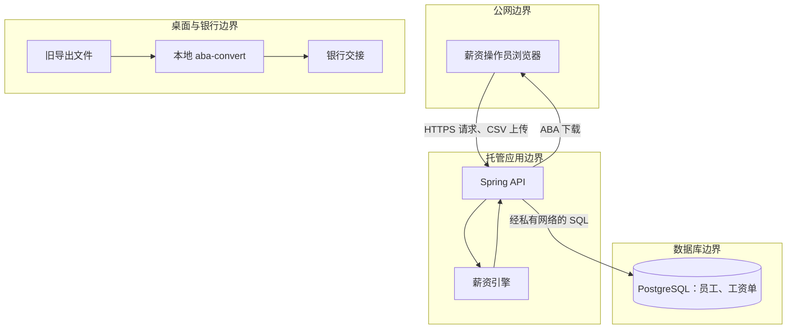

[English](threat-model.md) | 简体中文

# Payslate Online 威胁模型

本模型覆盖托管的薪资服务：Spring API、其 PostgreSQL 存储、薪资引擎、ABA 导出，以及至今仍用来准备银行文件的
继承桌面转换器。本仓库的数据全部为合成数据。税号是计划中的字段，暂不存储；存储中确有 BSB 与账号、时薪，以及
每张工资单上的税前、税额和税后金额。

| 元素／边界 | STRIDE 关注点 | 敏感数据与后果 | 缓解与状态 |
| --- | --- | --- | --- |
| 浏览器到 API | 仿冒、篡改、抵赖 | 调用方可能冒充其他操作员，或否认某次操作 | OIDC bearer 认证与操作员／员工角色校验已具备并验证；被拒绝的请求（401、403 及记录不存在所产生的 404）已记入安全事件日志，并在仪表盘中计数；成功读取和数据变更的完整审计仍待完成 |
| 搜索文本到 SQL | 篡改、信息泄露 | 注入可能泄露其他员工的薪率 | 参数绑定已修复；PostgreSQL 回归测试与 SpotBugs、Semgrep 门禁予以验证 |
| CSV 上传到 API | 拒绝服务、篡改 | 畸形或超大文件可能耗尽资源 | [ADR 0012](../adr/0012-timesheet-upload-limits.zh-CN.md) 的限制已落实：严格 UTF-8，单文件及 multipart 请求上限均为 1 MB，最多 10 000 行数据，年份为 2000–2099，员工姓名去除首尾空白后为 1–100 个字符且不含控制字符（包括制表符）；已采用线性流式解析、带行号的 400、通用 500 problem 和 JUnit 回归测试；已通过测试活动重放验证（种子 `20260717`，1 500 个候选输入，未触发任何问题判定） |
| 同一员工的 CSV 上传 | 篡改 | 重复上传或重叠班次可能导致重复计薪；同一文件上传两次就会支付两次工资 | 上传时现已拒绝同一员工的重叠或重复班次：同一文件内重叠返回 400，与已存储班次重叠返回 409，均指出出错的行号；并发的重复上传通过员工行锁排队、依次处理（见 [ADR 0013](../adr/0013-reject-overlapping-timesheet-shifts.zh-CN.md)）；暂不引入用于上传内容去重的幂等键，原因见 ADR 0013；修复前多付的工资另行核对处理 |
| API 到 PostgreSQL | 信息泄露、权限提升 | 查询可能越过雇主边界 | 私有连通性与按雇主限定的查询已验证；最小权限与静态加密尚待完成 |
| API 到薪资引擎到工资单 | 篡改、抵赖 | 错误金额可能进入已核准的工资单 | 引擎特征化与状态测试已具备；不可变的核准记录尚待完成 |
| API 到操作员 ABA 下载 | 信息泄露、篡改 | 可能下载到其他雇主的银行文件 | 已付状态与按雇主限定的授权已具备；导出时将员工姓名转换为符合银行文件要求的账户名；下载审计及为每位员工增设独立的银行账户名字段尚待完成 |
| 旧导出到 aba-convert | 篡改、拒绝服务 | 构造的文件可能破坏本地转换器的内存 | 在 ASan/UBSan 下复现的账户名复制栈缓冲区溢出和批次合计整数溢出现均已修复：账户名复制长度限制为输出字段所容纳的 24 个字符，批次合计采用 64 位整数运算进行累加和范围校验；sanitizer 回归用例 [fuzz/crashes/name-overflow.txt](../../legacy/aba-convert/fuzz/crashes/name-overflow.txt) 和 [fuzz/crashes/total-overflow.txt](../../legacy/aba-convert/fuzz/crashes/total-overflow.txt) 由 [tests/run-sanitizers.sh](../../legacy/aba-convert/tests/run-sanitizers.sh) 重放；已将覆盖率引导的模糊测试作为防护措施，使用 Jazzer 测试解析器，在本地使用 AFL++ 测试转换器（见 [ADR 0014](../adr/0014-scheduled-fuzzing.zh-CN.md)） |
| 本地 ABA 到银行交接 | 仿冒、篡改 | 被改动的文件可能送达银行 | 每份导出都要求带控制尾记录（记录条数与合计），`aba-convert` 在对账相符之前不写输出，截断或篡改金额的导出会被拒绝（见 [ADR 0015](../adr/0015-require-a-control-trailer-on-desktop-exports.zh-CN.md)）；对银行的经认证传输仍待完成 |

STRIDE 指仿冒、篡改、抵赖、信息泄露、拒绝服务和权限提升。静态分析的发现标记的是待审查的风险，而非已证实的完整
利用链。当前 API 会校验 OIDC token，并对每次数据库查询按雇主限定；标记为尚待完成的项留待后续工作。
