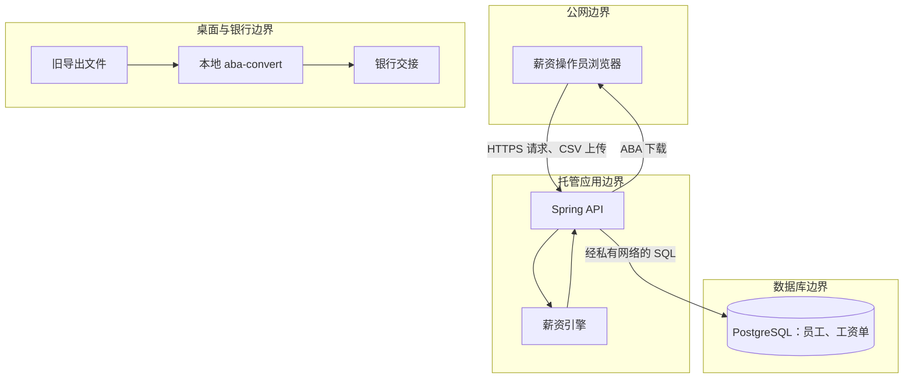

[English](threat-model.md) | 简体中文

# Payslate Online 威胁模型

本模型覆盖托管的薪资服务：Spring API、其 PostgreSQL 存储、薪资引擎、ABA 导出，以及至今仍用来准备银行文件的
继承桌面转换器。本仓库的数据全部为合成数据。税号是计划中的字段，暂不存储；存储中确有 BSB 与账号、时薪，以及
每张工资单上的税前、税额和税后金额。

| 元素／边界 | STRIDE 关注点 | 敏感数据与后果 | 缓解与状态 |
| --- | --- | --- | --- |
| 浏览器到 API | 仿冒、篡改、抵赖 | 调用方可能冒充其他操作员，或否认某次操作 | OIDC bearer 认证与操作员／员工角色校验已具备并验证；请求审计尚待完成 |
| 搜索文本到 SQL | 篡改、信息泄露 | 注入可能泄露其他员工的薪率 | 参数绑定已修复；PostgreSQL 回归测试与 SpotBugs、Semgrep 门禁予以验证 |
| CSV 上传到 API | 拒绝服务、篡改 | 畸形或超大文件可能耗尽资源 | 格式解析器已具备；大小限制与有界流式处理尚待完成 |
| API 到 PostgreSQL | 信息泄露、权限提升 | 查询可能越过雇主边界 | 私有连通性与按雇主限定的查询已验证；最小权限与静态加密尚待完成 |
| API 到薪资引擎到工资单 | 篡改、抵赖 | 错误金额可能进入已核准的工资单 | 引擎特征化与状态测试已具备；不可变的核准记录尚待完成 |
| API 到操作员 ABA 下载 | 信息泄露、篡改 | 可能下载到其他雇主的银行文件 | 已付状态与按雇主限定的授权已具备；下载审计尚待完成 |
| 旧导出到 aba-convert | 篡改、拒绝服务 | 构造的文件可能破坏本地转换器的内存 | 基于 sanitizer 的健壮性审查尚待开展；有界姓名拷贝与带校验的批次合计尚待完成 |
| 本地 ABA 到银行交接 | 仿冒、篡改 | 被改动的文件可能送达银行 | 文件格式校验部分具备；经认证的传输与对账尚待完成 |

STRIDE 指仿冒、篡改、抵赖、信息泄露、拒绝服务和权限提升。静态分析的发现标记的是待审查的风险，而非已证实的完整
利用链。当前 API 会校验 OIDC token，并对每次数据库查询按雇主限定；标记为尚待完成的项留待后续工作。
