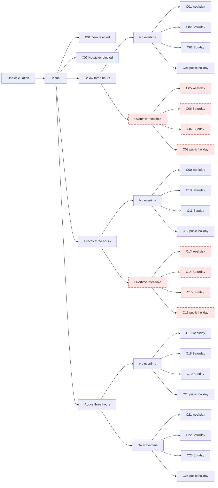
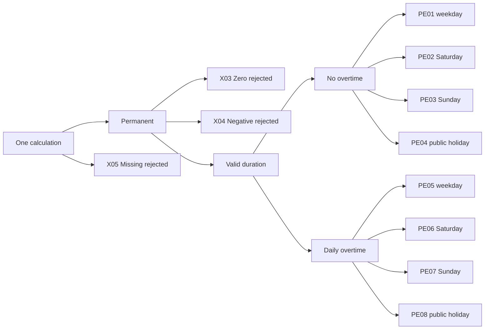

English | [简体中文](casual-partitions.zh-CN.md)

# Casual employee input partitions

Olivia Brooks — 2026-03-10

This note uses the call scope of `CasualPartitionsTest`: each case starts a fresh `LegacyPayEngine.calculate` call at $20/hour with one `Shift` and no prior shifts. Direct inputs are `Employment`, start, end and `publicHoliday`; duration, daily overtime and day class are derived from them. `leaveHours` is an output, not a leave-request input. The oracle is the [casual employee specification](../specs/casual-employees.md), confirmed by Margaret O'Connell.

The tree enumerates combinations of the categories used by these tests, not every input to the API. Valid durations are 1–1,440 whole minutes; zero and negative durations are separate rejection inputs. Timestamps are non-null. Day class means the class applying to paid minutes; representative shifts, including top-up, do not cross day classes. Midnight rate changes, durations over 24 hours, missing timestamps, sub-minute inputs and multiple-shift accumulation need additional partitions. One shift has at most 1,440 paid minutes, below the weekly threshold of 2,280, so this tree splits only daily overtime. The current weekly counter does not reset by calendar week, and cross-week inputs are not rejected by validation.

Each level expands one dimension, for the following reasons.

| Level | Classes | Reason in the code and rule |
| --- | --- | --- |
| 1 Employment | permanent, casual, missing | Only casual has loading, a three-hour minimum and zero leave; entry rejects `employment == null`. |
| 2 Duration | casual: zero, negative, below three hours, exactly three, above three; permanent: zero, negative, valid | `!end.isAfter(start)` rejects equal or reversed endpoints; `minutes < 1` rejects less than one whole minute. Only casual uses the `paidMinutes < 180` top-up, so three hours does not split permanent shifts. |
| 3 Daily overtime | none, some | After 480 paid minutes on a date, the next minute is overtime. Overtime takes the higher of day rate and overtime tier, without loading. “Some” means more than eight hours on the date, not an independently supplied switch. |
| 4 Day class | weekday, Saturday, Sunday, public holiday | Factors are 1.0, 1.25, 1.5 and 2.25. `publicHoliday` is checked first; only non-holidays are classified by weekday/weekend. |

Rejected inputs stop before the remaining dimensions. The two drawings show one tree: casual first, then permanent and missing employment. “One calculation” is the same root in both. Red dashed nodes mark infeasible paths; their four day leaves are still drawn for an explicit enumeration.

A casual shift below three hours is topped up to 180 minutes; an exactly-three-hour shift also has 180. Top-up minutes do increment `dailyMinutes`: on one date the first iteration reads 0 and the last reads 179, then stores 180. Daily overtime requires a prior count of at least 480. Crossing midnight can only distribute those 180 minutes between dates. Thus C05–C08 and C13–C16 are infeasible, not merely unselected. Zero, negative and missing-employment inputs can actually be supplied, so they are feasible rejection leaves.

The full leaf table records every path, feasibility and existing representative. “Not selected” means neither a proven defect nor an impossible path.

| ID | Root-to-leaf path | Feasibility and reason | Representative test |
| --- | --- | --- | --- |
| C01 | casual / below three hours / no overtime / weekday | Feasible; A single shift can meet these conditions. | `casual_weekday_below_minimum` |
| C02 | casual / below three hours / no overtime / Saturday | Feasible; A single shift can meet these conditions. | not selected |
| C03 | casual / below three hours / no overtime / Sunday | Feasible; A single shift can meet these conditions. | not selected |
| C04 | casual / below three hours / no overtime / public holiday | Feasible; A single shift can meet these conditions. | not selected |
| C05 | casual / below three hours / daily overtime / weekday | **Infeasible**; Paid minutes total 180; no date can reach minute 481. | not selected |
| C06 | casual / below three hours / daily overtime / Saturday | **Infeasible**; Paid minutes total 180; no date can reach minute 481. | not selected |
| C07 | casual / below three hours / daily overtime / Sunday | **Infeasible**; Paid minutes total 180; no date can reach minute 481. | not selected |
| C08 | casual / below three hours / daily overtime / public holiday | **Infeasible**; Paid minutes total 180; no date can reach minute 481. | not selected |
| C09 | casual / exactly three hours / no overtime / weekday | Feasible; A single shift can meet these conditions. | `casual_weekday_at_minimum` |
| C10 | casual / exactly three hours / no overtime / Saturday | Feasible; A single shift can meet these conditions. | `casual_saturday_ordinary` |
| C11 | casual / exactly three hours / no overtime / Sunday | Feasible; A single shift can meet these conditions. | `casual_sunday_ordinary` |
| C12 | casual / exactly three hours / no overtime / public holiday | Feasible; A single shift can meet these conditions. | `casual_public_holiday_interaction` |
| C13 | casual / exactly three hours / daily overtime / weekday | **Infeasible**; Paid minutes total 180; no date can reach minute 481. | not selected |
| C14 | casual / exactly three hours / daily overtime / Saturday | **Infeasible**; Paid minutes total 180; no date can reach minute 481. | not selected |
| C15 | casual / exactly three hours / daily overtime / Sunday | **Infeasible**; Paid minutes total 180; no date can reach minute 481. | not selected |
| C16 | casual / exactly three hours / daily overtime / public holiday | **Infeasible**; Paid minutes total 180; no date can reach minute 481. | not selected |
| C17 | casual / above three hours / no overtime / weekday | Feasible; A single shift can meet these conditions. | `casual_weekday_above_minimum` |
| C18 | casual / above three hours / no overtime / Saturday | Feasible; A single shift can meet these conditions. | not selected |
| C19 | casual / above three hours / no overtime / Sunday | Feasible; A single shift can meet these conditions. | not selected |
| C20 | casual / above three hours / no overtime / public holiday | Feasible; A single shift can meet these conditions. | not selected |
| C21 | casual / above three hours / daily overtime / weekday | Feasible; A single shift can meet these conditions. | `casual_overtime_no_loading` |
| C22 | casual / above three hours / daily overtime / Saturday | Feasible; A single shift can meet these conditions. | not selected |
| C23 | casual / above three hours / daily overtime / Sunday | Feasible; A single shift can meet these conditions. | not selected |
| C24 | casual / above three hours / daily overtime / public holiday | Feasible; A single shift can meet these conditions. | not selected |
| PE01 | permanent / valid duration / no overtime / weekday | Feasible; A single shift can meet these conditions. | `permanent_weekday_no_minimum` |
| PE02 | permanent / valid duration / no overtime / Saturday | Feasible; A single shift can meet these conditions. | not selected |
| PE03 | permanent / valid duration / no overtime / Sunday | Feasible; A single shift can meet these conditions. | not selected |
| PE04 | permanent / valid duration / no overtime / public holiday | Feasible; A single shift can meet these conditions. | not selected |
| PE05 | permanent / valid duration / daily overtime / weekday | Feasible; A single shift can meet these conditions. | not selected |
| PE06 | permanent / valid duration / daily overtime / Saturday | Feasible; A single shift can meet these conditions. | not selected |
| PE07 | permanent / valid duration / daily overtime / Sunday | Feasible; A single shift can meet these conditions. | not selected |
| PE08 | permanent / valid duration / daily overtime / public holiday | Feasible; A single shift can meet these conditions. | not selected |
| X01 | casual / zero duration | Feasible rejection input; Equal endpoints fail end.isAfter(start). | `invalid_zero_duration` |
| X02 | casual / negative duration | Feasible rejection input; Reversed endpoints fail end.isAfter(start). | `invalid_negative_duration` |
| X03 | permanent / zero duration | Feasible rejection input; Equal endpoints fail the same employment-independent guard. | not selected |
| X04 | permanent / negative duration | Feasible rejection input; Reversed endpoints fail the same employment-independent guard. | not selected |
| X05 | missing employment | Feasible rejection input; employment == null is rejected at entry. | `invalid_null_employment` |

Casual valid-duration branches have 3 × 2 × 4 = 24 leaves: eight infeasible and 16 feasible. Permanent valid-duration branches have 2 × 4 = 8. There are five early-rejection leaves. Total: 37 leaves, 29 feasible (24 valid-input and five rejection-input leaves). The 11 existing representatives cover eight valid and three rejection leaves, leaving 18 feasible leaves without a representative in this class.

## Choosing representatives

Base choice starts at C09: casual / exactly three hours / no overtime / weekday, named `casual_weekday_at_minimum`. Changing day class gives C10, C11 and C12; changing duration gives C01 and C17. Changing only overtime would reach infeasible C13, so C21 also changes duration to nine hours: eight ordinary hours and one overtime hour without loading.

PE01 is the employment contrast. Permanent has one valid-duration class; choosing one hour makes the absence of the minimum observable, whereas three hours would show only loading and leave differences. Strictly, this concrete input changes both `Employment` and end time. This is base choice with a deliberate contrast, not a claim that every case changes only one raw argument. X01, X02 and X05 cover three rejection inputs. Permanent zero/negative cases are not repeated because `!s.end().isAfter(s.start())` and `minutes < 1` both precede `if (employment == Employment.CASUAL && paidMinutes < 180)` and do not branch on employment. X03 and X04 remain explicitly untested leaves.

The selected representatives have these expected amounts and leave outcomes. Invalid inputs return no payslip, hence no gross or leave result.

| Leaf | Test name | Input at $20/hour | Expected gross and leave |
| --- | --- | --- | --- |
| C01 | `casual_weekday_below_minimum` | 2026-02-16 10:00–11:00, casual, holiday false | 180 × 20 × 1.25 / 60 = 75.00; leave 0.0000 |
| C09 | `casual_weekday_at_minimum` | 2026-02-16 10:00–13:00, casual, false | 180 × 20 × 1.25 / 60 = 75.00; leave 0.0000 |
| C17 | `casual_weekday_above_minimum` | 2026-02-16 10:00–14:00, casual, false | 240 × 20 × 1.25 / 60 = 100.00; leave 0.0000 |
| C10 | `casual_saturday_ordinary` | 2026-02-14 10:00–13:00, casual, false | 180 × 20 × (1.25 + .25) / 60 = 90.00; leave 0.0000 |
| C11 | `casual_sunday_ordinary` | 2026-02-15 10:00–13:00, casual, false | 180 × 20 × (1.5 + .25) / 60 = 105.00; leave 0.0000 |
| C12 | `casual_public_holiday_interaction` | 2026-02-16 10:00–13:00, casual, true | 180 × 20 × (2.25 + .25) / 60 = 150.00; leave 0.0000 |
| PE01 | `permanent_weekday_no_minimum` | 2026-02-16 10:00–11:00, permanent, false | 60 × 20 / 60 = 20.00; leave 0.0769, only positivity asserted |
| C21 | `casual_overtime_no_loading` | 2026-02-16 09:00–18:00, casual, false | 480 × 20 × 1.25 / 60 + 60 × 20 × 1.5 / 60 = 230.00; leave 0.0000 |
| X01 | `invalid_zero_duration` | 2026-02-16 10:00–10:00, casual, false | `IllegalArgumentException`; no payslip |
| X02 | `invalid_negative_duration` | 2026-02-16 11:00–10:00, casual, false | `IllegalArgumentException`; no payslip |
| X05 | `invalid_null_employment` | 2026-02-16 10:00–11:00, employment null, false | `IllegalArgumentException`; no payslip |

Valid tests check gross and `leaveHours().signum() > 0`. For casual, expected false excludes positive leave but would not reject negative leave; 0.0000 is the expected implementation result. One permanent ordinary hour accrues 1 × 0.076923, rounded to 0.0769; that assertion also does not check the exact amount.

## Feasible leaves not selected

The table identifies all 18 gaps and what each would add. Amounts are proposed expectations derived from the rule, not claims of existing tests. Casual candidates have zero leave. One-hour permanent candidates accrue 0.0769; nine-hour permanent candidates accrue leave on eight ordinary hours only: 8 × 0.076923 = 0.615384, rounded to 0.6154.

| Uncovered leaf | What an additional representative would check |
| --- | --- |
| C02 | 1 × 60 minutes topped up to 180; Saturday: 3 × 20 × (1.25 + .25) = 90.00. |
| C03 | One hour topped up on Sunday: 3 × 20 × (1.5 + .25) = 105.00. |
| C04 | One hour topped up on a holiday: 3 × 20 × (2.25 + .25) = 150.00. |
| C18 | Four ordinary Saturday hours: 4 × 20 × 1.50 = 120.00. |
| C19 | Four ordinary Sunday hours: 4 × 20 × 1.75 = 140.00. |
| C20 | Four ordinary holiday hours: 4 × 20 × 2.50 = 200.00. |
| C22 | Nine Saturday hours: 8 × 20 × 1.50 + 20 × max(1.5, 1.25) = 270.00. |
| C23 | Nine Sunday hours: 8 × 20 × 1.75 + 20 × max(1.5, 1.5) = 310.00. |
| C24 | Nine holiday hours: 8 × 20 × 2.50 + 20 × max(1.5, 2.25) = 445.00. |
| PE02 | One Saturday hour without minimum or loading: 20 × 1.25 = 25.00. |
| PE03 | One Sunday hour without minimum or loading: 20 × 1.5 = 30.00. |
| PE04 | One holiday hour without minimum or loading: 20 × 2.25 = 45.00. |
| PE05 | Nine weekday hours: 8 × 20 + 20 × 1.5 = 190.00. |
| PE06 | Nine Saturday hours: 8 × 20 × 1.25 + 20 × max(1.5, 1.25) = 230.00. |
| PE07 | Nine Sunday hours: 8 × 20 × 1.5 + 20 × max(1.5, 1.5) = 270.00. |
| PE08 | Nine holiday hours: 8 × 20 × 2.25 + 20 × max(1.5, 2.25) = 405.00. |
| X03 | Permanent zero duration: exercise the shared rejection guard with the other employment type. |
| X04 | Permanent negative duration: exercise the shared rejection guard with the other employment type. |
