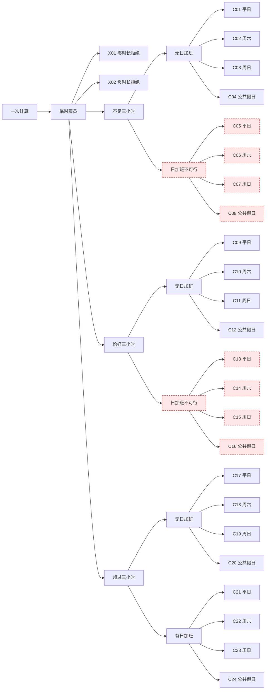
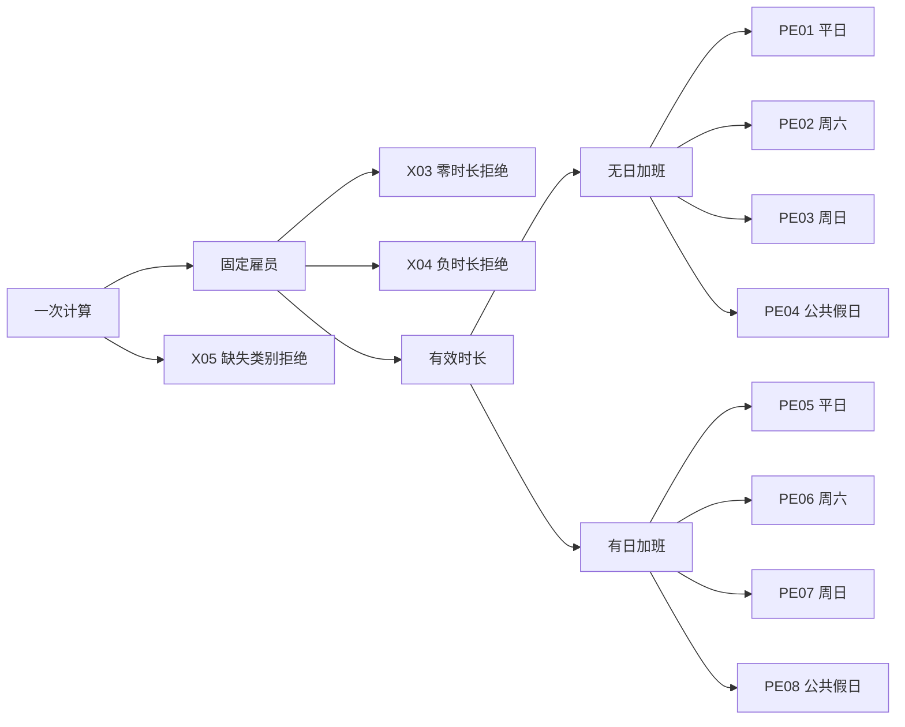

[English](casual-partitions.md) | 简体中文

# 临时雇员输入分区

Olivia Brooks — 2026-03-10

本笔记针对 `CasualPartitionsTest` 的调用范围：每例重新调用一次 `LegacyPayEngine.calculate`，基本时薪 $20，只传一条 `Shift`，没有此前班次。直接输入是 `Employment`、开始时间、结束时间和 `publicHoliday`；时长、日加班和日期类别由这些输入推导。`leaveHours` 是输出，不是请假输入。预期以 Margaret O'Connell 确认的[临时雇员规则](../specs/casual-employees.zh-CN.md)为准。

以下树枚举这些测试所用的类别组合，不是整个 API 的全部输入。有效时长限定为 1 至 1,440 个整分钟；把零与负时长另列为拒绝输入。时间戳非 null。日期这一层按付费分钟适用的日期类别划分；代表班次及补足部分不跨日期类别。跨午夜费率变化、超过 24 小时、缺失时间戳、亚分钟输入以及多班次累计需要另外的分区。单班次最多 1,440 分钟，达不到周门槛 2,280 分钟，因此此树只分日加班。当前周累计未按日历周重置，跨周输入也未被校验拒绝。

每层只展开一个维度，理由如下。

| 层 | 划分 | 代码与规则上的理由 |
| --- | --- | --- |
| 1 雇佣类别 | 固定、临时、缺失 | 只有临时雇员有 loading、三小时最低支付和零年假；入口拒绝 `employment == null`。 |
| 2 时长 | 临时：零、负、不足三小时、恰好三小时、超过三小时；固定：零、负、有效 | `!end.isAfter(start)` 拒绝零与反向班次，`minutes < 1` 拒绝不足一个完整分钟；只有临时类别执行 `paidMinutes < 180` 补足，所以固定雇员不按三小时再分。 |
| 3 日加班 | 无、有 | 当日已有 480 个付费分钟后，下一个分钟进入加班。加班取日期费率和加班档位中较高者，不加 loading。此处“有”是当日超过八小时，不是可独立传入的开关。 |
| 4 日期类别 | 平日、周六、周日、公共假日 | 倍率为 1.0、1.25、1.5、2.25；代码先看 `publicHoliday`，因此假日优先于星期几，非假日才分平日或周末。 |

一次输入被拒绝后，不再展开剩余维度。下图分成两幅展示同一棵树：第一幅是临时雇员，第二幅是固定雇员与缺失类别；两幅的“一次计算”是同一个根。红色虚线节点所在路径不可行，但仍画出四个日期叶子，便于逐一核对。

短于三小时的临时班次补足到 180 分钟，恰好三小时也只有 180 分钟。补足分钟照样进入 `dailyMinutes`：同一天第一个分钟读取旧值 0，最后一个读取 179，更新后是 180；日加班条件却要求旧值至少 480。跨午夜只会把这 180 分钟分到两天，不会让任何一天超过 480。因此 C05–C08 与 C13–C16 均不可行，不是尚未选择输入。零、负时长与缺失类别则能实际传入，是预期拒绝的可行叶子。

以下逐叶列出路径、可行性与现有代表。“未选代表”不等于实现错误，也不等于这条路径不可能出现。

| 编号 | 从根到叶的路径 | 可行性与原因 | 代表测试 |
| --- | --- | --- | --- |
| C01 | 临时／不足三小时／无日加班／平日 | 可行；可用单班次构造。 | `casual_weekday_below_minimum` |
| C02 | 临时／不足三小时／无日加班／周六 | 可行；可用单班次构造。 | 未选代表 |
| C03 | 临时／不足三小时／无日加班／周日 | 可行；可用单班次构造。 | 未选代表 |
| C04 | 临时／不足三小时／无日加班／公共假日 | 可行；可用单班次构造。 | 未选代表 |
| C05 | 临时／不足三小时／有日加班／平日 | **不可行**；总付费分钟仅 180，任何一天都到不了第 481 分钟。 | 未选代表 |
| C06 | 临时／不足三小时／有日加班／周六 | **不可行**；总付费分钟仅 180，任何一天都到不了第 481 分钟。 | 未选代表 |
| C07 | 临时／不足三小时／有日加班／周日 | **不可行**；总付费分钟仅 180，任何一天都到不了第 481 分钟。 | 未选代表 |
| C08 | 临时／不足三小时／有日加班／公共假日 | **不可行**；总付费分钟仅 180，任何一天都到不了第 481 分钟。 | 未选代表 |
| C09 | 临时／恰好三小时／无日加班／平日 | 可行；可用单班次构造。 | `casual_weekday_at_minimum` |
| C10 | 临时／恰好三小时／无日加班／周六 | 可行；可用单班次构造。 | `casual_saturday_ordinary` |
| C11 | 临时／恰好三小时／无日加班／周日 | 可行；可用单班次构造。 | `casual_sunday_ordinary` |
| C12 | 临时／恰好三小时／无日加班／公共假日 | 可行；可用单班次构造。 | `casual_public_holiday_interaction` |
| C13 | 临时／恰好三小时／有日加班／平日 | **不可行**；总付费分钟仅 180，任何一天都到不了第 481 分钟。 | 未选代表 |
| C14 | 临时／恰好三小时／有日加班／周六 | **不可行**；总付费分钟仅 180，任何一天都到不了第 481 分钟。 | 未选代表 |
| C15 | 临时／恰好三小时／有日加班／周日 | **不可行**；总付费分钟仅 180，任何一天都到不了第 481 分钟。 | 未选代表 |
| C16 | 临时／恰好三小时／有日加班／公共假日 | **不可行**；总付费分钟仅 180，任何一天都到不了第 481 分钟。 | 未选代表 |
| C17 | 临时／超过三小时／无日加班／平日 | 可行；可用单班次构造。 | `casual_weekday_above_minimum` |
| C18 | 临时／超过三小时／无日加班／周六 | 可行；可用单班次构造。 | 未选代表 |
| C19 | 临时／超过三小时／无日加班／周日 | 可行；可用单班次构造。 | 未选代表 |
| C20 | 临时／超过三小时／无日加班／公共假日 | 可行；可用单班次构造。 | 未选代表 |
| C21 | 临时／超过三小时／有日加班／平日 | 可行；可用单班次构造。 | `casual_overtime_no_loading` |
| C22 | 临时／超过三小时／有日加班／周六 | 可行；可用单班次构造。 | 未选代表 |
| C23 | 临时／超过三小时／有日加班／周日 | 可行；可用单班次构造。 | 未选代表 |
| C24 | 临时／超过三小时／有日加班／公共假日 | 可行；可用单班次构造。 | 未选代表 |
| PE01 | 固定／有效时长／无日加班／平日 | 可行；可用单班次构造。 | `permanent_weekday_no_minimum` |
| PE02 | 固定／有效时长／无日加班／周六 | 可行；可用单班次构造。 | 未选代表 |
| PE03 | 固定／有效时长／无日加班／周日 | 可行；可用单班次构造。 | 未选代表 |
| PE04 | 固定／有效时长／无日加班／公共假日 | 可行；可用单班次构造。 | 未选代表 |
| PE05 | 固定／有效时长／有日加班／平日 | 可行；可用单班次构造。 | 未选代表 |
| PE06 | 固定／有效时长／有日加班／周六 | 可行；可用单班次构造。 | 未选代表 |
| PE07 | 固定／有效时长／有日加班／周日 | 可行；可用单班次构造。 | 未选代表 |
| PE08 | 固定／有效时长／有日加班／公共假日 | 可行；可用单班次构造。 | 未选代表 |
| X01 | 临时／零时长 | 可行，预期拒绝；起止相同，未通过 end.isAfter(start)。 | `invalid_zero_duration` |
| X02 | 临时／负时长 | 可行，预期拒绝；结束早于开始，未通过 end.isAfter(start)。 | `invalid_negative_duration` |
| X03 | 固定／零时长 | 可行，预期拒绝；起止相同，在不区分雇佣类别的校验处拒绝。 | 未选代表 |
| X04 | 固定／负时长 | 可行，预期拒绝；结束早于开始，在不区分雇佣类别的校验处拒绝。 | 未选代表 |
| X05 | 缺失雇佣类别 | 可行，预期拒绝；入口发现 employment == null，立即拒绝。 | `invalid_null_employment` |

临时的有效时长分支有 3 × 2 × 4 = 24 叶，其中 8 叶不可行、16 叶可行；固定的有效时长分支有 2 × 4 = 8 叶；提前拒绝的叶子有 5 个。总计 37 叶，29 个可行叶子中有 24 个有效输入叶子、5 个拒绝输入叶子。11 个现有代表覆盖 8 个有效叶子与 3 个拒绝叶子，剩余 18 个可行叶子没有本测试类的代表。

## 怎样选择代表

基准选择（base choice）从 C09 开始：临时／恰好三小时／无日加班／平日，测试名为 `casual_weekday_at_minimum`。固定其他类别后，改变日期得到 C10、C11、C12；改变时长得到 C01 和 C17。不能只把基准的日加班改为“有”，因为那会进入不可行的 C13。因此 C21 同时把时长改成九小时，以八个普通小时加一个加班小时验证不加 loading。

雇佣类别的对照选 PE01。固定雇员只有“有效时长”这一类，选一小时可同时看出没有三小时最低支付；如果仍用三小时，只能观察 loading 与年假差别。严格说，这个具体输入同时改变了 `Employment` 和结束时间，是基准选择加上有意挑选的对照，并非所有案例都只改一个原始参数。X01、X02、X05 分别验证三种拒绝输入。固定雇员零与负时长没有重复选择，因为 `!s.end().isAfter(s.start())` 与 `minutes < 1` 都在 `if (employment == Employment.CASUAL && paidMinutes < 180)` 之前，不区分雇佣类别；但 X03、X04 仍保留为未测叶子。

以下列出所有选中代表的金额与年假。无效输入没有工资单，也就没有总额与年假结果。

| 叶子 | 测试名 | 输入，基本时薪 $20 | 预期总额与年假 |
| --- | --- | --- | --- |
| C01 | `casual_weekday_below_minimum` | 2026-02-16 10:00–11:00，临时，假日 false | 180 × 20 × 1.25 / 60 = 75.00；年假 0.0000 |
| C09 | `casual_weekday_at_minimum` | 2026-02-16 10:00–13:00，临时，false | 180 × 20 × 1.25 / 60 = 75.00；年假 0.0000 |
| C17 | `casual_weekday_above_minimum` | 2026-02-16 10:00–14:00，临时，false | 240 × 20 × 1.25 / 60 = 100.00；年假 0.0000 |
| C10 | `casual_saturday_ordinary` | 2026-02-14 10:00–13:00，临时，false | 180 × 20 × (1.25 + .25) / 60 = 90.00；年假 0.0000 |
| C11 | `casual_sunday_ordinary` | 2026-02-15 10:00–13:00，临时，false | 180 × 20 × (1.5 + .25) / 60 = 105.00；年假 0.0000 |
| C12 | `casual_public_holiday_interaction` | 2026-02-16 10:00–13:00，临时，true | 180 × 20 × (2.25 + .25) / 60 = 150.00；年假 0.0000 |
| PE01 | `permanent_weekday_no_minimum` | 2026-02-16 10:00–11:00，固定，false | 60 × 20 / 60 = 20.00；年假 0.0769，测试只断言大于零 |
| C21 | `casual_overtime_no_loading` | 2026-02-16 09:00–18:00，临时，false | 480 × 20 × 1.25 / 60 + 60 × 20 × 1.5 / 60 = 230.00；年假 0.0000 |
| X01 | `invalid_zero_duration` | 2026-02-16 10:00–10:00，临时，false | `IllegalArgumentException`；无工资单 |
| X02 | `invalid_negative_duration` | 2026-02-16 11:00–10:00，临时，false | `IllegalArgumentException`；无工资单 |
| X05 | `invalid_null_employment` | 2026-02-16 10:00–11:00，类别 null，false | `IllegalArgumentException`；无工资单 |

有效测试检查总额及 `leaveHours().signum() > 0`。对临时雇员，预期布尔值 false 实际只排除正值，并不严格排除负年假；0.0000 是实现的预期输出。固定雇员的一小时年假为 1 × 0.076923，保留四位小数是 0.0769；其断言也没有核对精确数值。

## 未选中的可行叶子

下表逐一说明 18 个空位能增加什么检查。列出的金额是按规则推算的候选预期，不是声称已有测试。临时候选年假均为零；固定一小时候选年假 0.0769，九小时候选仅八小时普通工时累计年假，8 × 0.076923 = 0.615384，舍入为 0.6154。

| 未覆盖叶子 | 增加代表能检查什么 |
| --- | --- |
| C02 | 一小时补足为 180 分钟；检查周六补足部分也按 1.25 + .25 计费：3 × 20 × 1.50 = 90.00。 |
| C03 | 一小时补足遇到周日：3 × 20 × (1.5 + .25) = 105.00。 |
| C04 | 一小时补足遇到公共假日：3 × 20 × (2.25 + .25) = 150.00。 |
| C18 | 四小时周六班不补足，全部加 loading：4 × 20 × 1.50 = 120.00。 |
| C19 | 四小时周日班不补足，全部加 loading：4 × 20 × 1.75 = 140.00。 |
| C20 | 四小时假日班不补足，全部加 loading：4 × 20 × 2.50 = 200.00。 |
| C22 | 九小时周六班：8 × 20 × 1.50 + 20 × max(1.5, 1.25) = 270.00；第九小时取加班档位。 |
| C23 | 九小时周日班：8 × 20 × 1.75 + 20 × max(1.5, 1.5) = 310.00；两倍率相同，不再加 loading。 |
| C24 | 九小时假日班：8 × 20 × 2.50 + 20 × max(1.5, 2.25) = 445.00；日期费率胜过加班档位。 |
| PE02 | 固定雇员周六一小时，不补足、不加 loading：20 × 1.25 = 25.00。 |
| PE03 | 固定雇员周日一小时，不补足、不加 loading：20 × 1.5 = 30.00。 |
| PE04 | 固定雇员假日一小时，不补足、不加 loading：20 × 2.25 = 45.00。 |
| PE05 | 固定雇员平日九小时：8 × 20 + 20 × 1.5 = 190.00；核对普通与加班的分界。 |
| PE06 | 固定雇员周六九小时：8 × 20 × 1.25 + 20 × max(1.5, 1.25) = 230.00。 |
| PE07 | 固定雇员周日九小时：8 × 20 × 1.5 + 20 × max(1.5, 1.5) = 270.00。 |
| PE08 | 固定雇员假日九小时：8 × 20 × 2.25 + 20 × max(1.5, 2.25) = 405.00。 |
| X03 | 固定雇员零时长：以另一雇佣类别执行共用的拒绝条件。 |
| X04 | 固定雇员负时长：以另一雇佣类别执行共用的拒绝条件。 |
