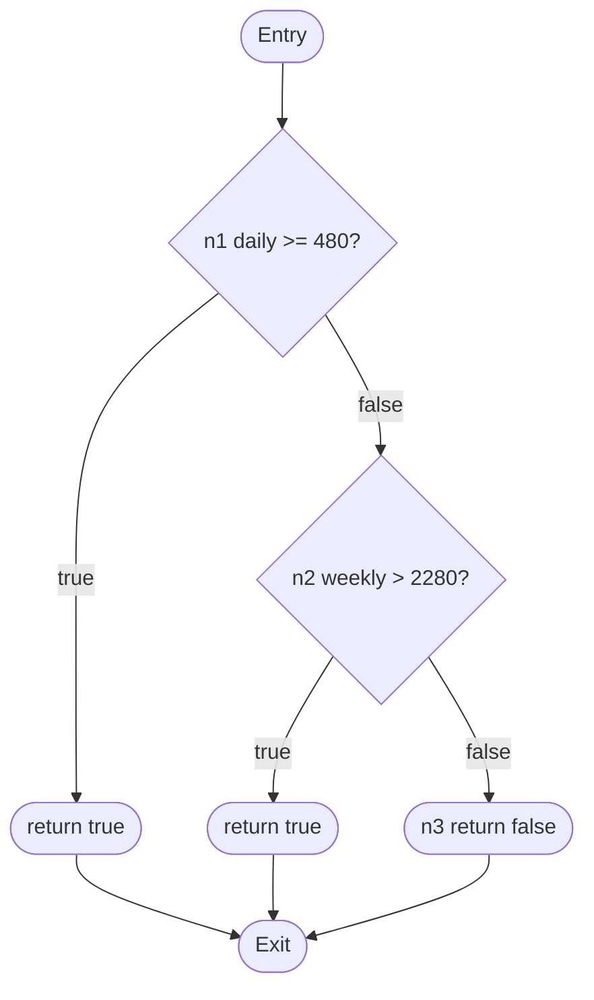

English | [简体中文](overtime-control-flow.zh-CN.md)

# Overtime control flow

Olivia Brooks — 2026-04-09

`LegacyPayEngine.isOvertime(daily, weekly)` receives the number of already paid minutes on the current day and the calendar-week count **including** the current minute. The daily argument excludes the current minute even though the map has already been updated. Daily minute 481 or weekly minute 2281 is overtime. Weekly counts and overtime tiers use the Monday-starting calendar week.

## Control-flow graph and source coverage

In `pay-engine/src/main/java/com/elsworne/payslate/engine/LegacyPayEngine.java`, the numbered comments identify the graph nodes:

```java
boolean isOvertime(int daily, int weekly) {
    /* n1 */ if (daily >= 8*60) return true;
    /* n2 */ if (weekly > 38*60) return true;
    /* n3 */ return false;
}
```



For source statement coverage, the two `if` conditions and three `return` statements count as five executable statements; entry and exit are excluded. Existing tests collectively reach all five: `ordinaryWeekdayShift` reaches `n3`; `daily_above_8h01` in `PayBoundariesTest.hourBoundaries` reaches the return at `n1`; `weekly_above_38h01` reaches the return at `n2`. **Hand statement coverage: 5/5 = 100%.**

The two decisions have four outcomes. Those tests collectively reach `n1` true/false and `n2` true/false, giving **hand branch coverage: 4/4 = 100%.** When `n1` is true, the method returns without evaluating `n2`. These are three complete paths: daily overtime, weekly-only overtime, and ordinary time. `daily_above_8h01` alone reaches three of the four decision outcomes; the weekly boundary case supplies `n2` true.

The earlier extracted implementation was `return daily >= 8*60 || weekly > 38*60;`. Rewriting it as the two numbered `if` statements preserves behaviour, but changes source-line and bytecode-instruction counts. The five-statement count above describes the current implementation.

## Measured coverage

Clean runs of `./mvnw -B -ntp clean verify` produced the following JaCoCo 0.8.16 counters, read from `pay-engine/target/site/jacoco/jacoco.xml`. Each fraction is covered/total. The HTML report is `pay-engine/target/site/jacoco/index.html`.

| Implementation and tests | Method | LINE | INSTRUCTION | BRANCH |
| --- | --- | --- | --- | --- |
| Extracted methods, before the holiday regression test | `isOvertime` | 1/1 | 10/10 | 4/4 |
| Extracted methods, before the holiday regression test | `overtimeFactor` | 2/2 | 12/12 | 3/4 |
| Holiday regression test and rate fix, before the numbered rewrite | `isOvertime` | 1/1 | 10/10 | 4/4 |
| Holiday regression test and rate fix, before the numbered rewrite | `overtimeFactor` | 2/2 | 8/8 | 2/2 |
| Current numbered implementation and rate fix | `isOvertime` | 3/3 | 12/12 | 4/4 |
| Current numbered implementation and rate fix | `overtimeFactor` | 2/2 | 8/8 | 2/2 |

JaCoCo's line counter is not a source-statement counter: the current `isOvertime` has three executable lines but five source statements. Bytecode instructions have a different denominator again.

| Implementation and tests | Bundle branches covered | Missed | Total | Coverage | `pay-engine` tests | `bank-file` tests |
| --- | --- | --- | --- | --- | --- | --- |
| Extracted methods, before the holiday regression test | 50 | 20 | 70 | 71.43% | 44 | 15 |
| Holiday regression test and rate fix, before the numbered rewrite | 49 | 19 | 68 | 72.06% | 45 | 15 |
| Current numbered implementation and rate fix | 49 | 19 | 68 | 72.06% | 45 | 15 |

All three clean runs passed their tests; counts include parameterized invocations. The current `pay-engine` bundle has **49 covered and 19 missed branches (72.06%)**. This module total does not describe every method. The team will decide a module floor separately; review should already inspect uncovered branches near changed award rules and check expected pay amounts.

## The inherited rate condition and its fix

Before the fix, the inherited `overtimeFactor` contained:

```java
double overtimeFactor(double factor, double tier) {
    if (factor < tier || factor > 2.0) factor = tier;
    return factor;
}
```

The condition came from the desktop engine and moved unchanged out of the minute loop when the method was extracted. Ordinary overtime made `factor < tier` true and skipped the second condition. However, existing tests also reached the second condition: `shiftCrossingSundayMidnightUsesNextWeeksThreshold` brings a Sunday overtime minute with `factor = 1.5` and `tier = 1.5`. Both comparisons are false, so the original factor is returned. The missing outcome was **`factor > 2.0` true**, not the entire second condition.

Counting the `if`, assignment and `return` gives **3/3 source statements** executed. Counting the true and false outcomes of each short-circuit condition gives **3/4 branch outcomes**. JaCoCo agrees on branches and reports **LINE 2/2, INSTRUCTION 12/12, BRANCH 3/4**. Full statement, line and instruction coverage still left the holiday defect undetected.

`LegacyPayEngineTest.holidayOvertimeKeepsHigherHolidayFactor` uses a nine-hour public-holiday shift at $10/hour and asserts gross pay of **$202.50**. All nine hours should retain the holiday factor of 2.25. Before the fix, the ninth hour reached `factor > 2.0` true and was reduced to the overtime tier of 1.5: `8 × $10 × 2.25 + 1 × $10 × 1.5 = $195.00`, an underpayment of **$7.50**. The regression test failed before the fix and passed afterward.

The fix removes `|| factor > 2.0`, leaving `if (factor < tier) factor = tier;`. Ordinary overtime takes the true branch; holiday overtime takes the false branch and retains 2.25. With the regression test, the method has **LINE 2/2, INSTRUCTION 8/8, BRANCH 2/2**. The branch denominator shrank because a condition was removed. Coverage shows which outcomes ran; the exact-amount assertion checks whether the pay is correct.

## Bounded path exercise

For the CSV loop in `PayCli.main`, restrict attention to valid arguments and at most two input lines. Group each line as blank/header (`S`, skipped) or valid shift (`A`, added). At this loop-skeleton level, the seven feasible paths are `[]`, `[S]`, `[A]`, `[S,S]`, `[S,A]`, `[A,S]`, `[A,A]`. They visit the loop condition once, twice or three times for zero, one or two lines respectively. This abstraction combines blank and header handling and excludes malformed input; it does not enumerate every bytecode path.

Without a bound, the loop has infinitely many paths, so this is bounded path coverage, not full path coverage. `pay-engine/demo-timesheet.csv` exercises `[S,A]` when run through the README command. The other six are hand-enumerated targets, not a claim about current tests.
