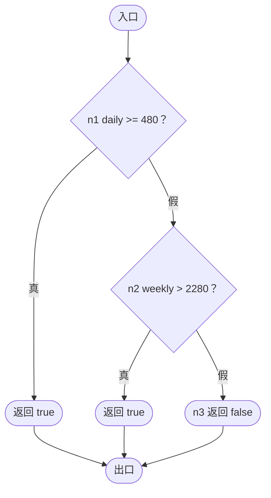

[English](overtime-control-flow.md) | 简体中文

# 加班控制流

Olivia Brooks — 2026-04-09

`LegacyPayEngine.isOvertime(daily, weekly)` 接收当天已经支付的分钟数，以及**包含当前分钟**的日历周累计分钟数。虽然调用前已经更新了日计数表，传入的 `daily` 仍不含当前分钟。当天第 481 分钟或当周第 2281 分钟属于加班。周累计分钟和加班倍率档都按星期一开始的日历周计算。

## 控制流图与源语句覆盖

`pay-engine/src/main/java/com/elsworne/payslate/engine/LegacyPayEngine.java` 中的编号注释对应图中节点：

```java
boolean isOvertime(int daily, int weekly) {
    /* n1 */ if (daily >= 8*60) return true;
    /* n2 */ if (weekly > 38*60) return true;
    /* n3 */ return false;
}
```



手算源语句覆盖时，两个 `if` 判断和三个 `return` 共五个可执行语句；入口和出口不计入分母。现有测试合起来执行了全部五个语句：`ordinaryWeekdayShift` 到达 `n3`；`PayBoundariesTest.hourBoundaries` 中的 `daily_above_8h01` 到达 `n1` 的返回语句；`weekly_above_38h01` 到达 `n2` 的返回语句。因此，**手算语句覆盖为 5/5 = 100%**。

两个判断各有真、假出口，共四个目标。上述测试合起来覆盖 `n1` 的真、假出口和 `n2` 的真、假出口，因此，**手算分支覆盖为 4/4 = 100%**。`n1` 为真时方法立即返回，不再执行 `n2`。完整路径有三条：日加班、仅周加班、普通工时。单独运行 `daily_above_8h01` 可覆盖四个判定出口中的三个；周边界用例补上 `n2` 为真的出口。

刚提取方法时，实现是 `return daily >= 8*60 || weekly > 38*60;`。改成两个带编号的 `if` 后，行为不变，但源码行数和字节码指令数发生了变化。上面的五个源语句指的是当前实现。

## 实测覆盖率

分别运行 `./mvnw -B -ntp clean verify` 后，从 `pay-engine/target/site/jacoco/jacoco.xml` 读取了以下 JaCoCo 0.8.16 计数。分数均为已覆盖数/总数。HTML 报告位于 `pay-engine/target/site/jacoco/index.html`。

| 实现与测试状态 | 方法 | LINE | INSTRUCTION | BRANCH |
| --- | --- | --- | --- | --- |
| 已提取方法，尚未加入节假日回归测试 | `isOvertime` | 1/1 | 10/10 | 4/4 |
| 已提取方法，尚未加入节假日回归测试 | `overtimeFactor` | 2/2 | 12/12 | 3/4 |
| 已加入节假日回归测试并修复倍率，尚未改写为编号语句 | `isOvertime` | 1/1 | 10/10 | 4/4 |
| 已加入节假日回归测试并修复倍率，尚未改写为编号语句 | `overtimeFactor` | 2/2 | 8/8 | 2/2 |
| 当前带编号的实现，倍率已修复 | `isOvertime` | 3/3 | 12/12 | 4/4 |
| 当前带编号的实现，倍率已修复 | `overtimeFactor` | 2/2 | 8/8 | 2/2 |

JaCoCo 的行计数不等于源语句计数：当前 `isOvertime` 有三行可执行源码，却有五个源语句。字节码指令又是另一种分母。

| 实现与测试状态 | bundle 已覆盖分支 | 未覆盖分支 | 分支总数 | 覆盖率 | `pay-engine` 测试数 | `bank-file` 测试数 |
| --- | --- | --- | --- | --- | --- | --- |
| 已提取方法，尚未加入节假日回归测试 | 50 | 20 | 70 | 71.43% | 44 | 15 |
| 已加入节假日回归测试并修复倍率，尚未改写为编号语句 | 49 | 19 | 68 | 72.06% | 45 | 15 |
| 当前带编号的实现，倍率已修复 | 49 | 19 | 68 | 72.06% | 45 | 15 |

三次 clean 验证中的测试均通过，测试数包含参数化测试的各次调用。当前 `pay-engine` bundle 有 **49 个已覆盖、19 个未覆盖分支，覆盖率为 72.06%**。这个模块总数不能代表每个方法。团队将另行决定模块的覆盖率底线；评审时应当先查看奖项规则改动附近未覆盖的分支，并核对预期工资金额。

## 继承的倍率条件及其修复

修复前，继承的 `overtimeFactor` 包含以下代码：

```java
double overtimeFactor(double factor, double tier) {
    if (factor < tier || factor > 2.0) factor = tier;
    return factor;
}
```

这个条件来自桌面版引擎，提取方法时从逐分钟循环中原样移入。普通加班使 `factor < tier` 为真，第二个条件因短路而不执行。不过，现有测试也走到了第二个条件：`shiftCrossingSundayMidnightUsesNextWeeksThreshold` 中的周日加班分钟使 `factor = 1.5`、`tier = 1.5`。两个比较均为假，方法返回原倍率。缺少的是 **`factor > 2.0` 为真**的结果，而非整个第二条件都没有执行。

把 `if`、赋值和 `return` 计为三个源语句，覆盖为 **3/3**。把两个短路条件各自的真、假结果计为分支目标，覆盖为 **3/4**。JaCoCo 的分支计数与此一致，报告 **LINE 2/2、INSTRUCTION 12/12、BRANCH 3/4**。即使语句、行和指令都已完全覆盖，节假日缺陷仍未被发现。

`LegacyPayEngineTest.holidayOvertimeKeepsHigherHolidayFactor` 设置了一个小时工资为 $10 的九小时公共假日班次，断言总工资为 **$202.50**。九小时都应保留 2.25 的节假日倍率。修复前，第九小时使 `factor > 2.0` 为真，倍率被降为加班档的 1.5：`8 × $10 × 2.25 + 1 × $10 × 1.5 = $195.00`，少付 **$7.50**。回归测试在修复前失败，修复后通过。

修复删除了 `|| factor > 2.0`，只保留 `if (factor < tier) factor = tier;`。普通加班走真分支；节假日加班走假分支，保留 2.25。加入回归测试后，该方法的计数为 **LINE 2/2、INSTRUCTION 8/8、BRANCH 2/2**。分支分母变小，是因为删除了一个条件。覆盖率说明哪些结果执行过；精确金额断言才检查工资是否正确。

## 有界路径练习

对于 `PayCli.main` 的 CSV 循环，只考虑有效命令行参数和最多两条输入行。每行归为两类：空白或表头（`S`，跳过），或者合法班次（`A`，加入）。在这个循环骨架层面，七条可行路径为 `[]`、`[S]`、`[A]`、`[S,S]`、`[S,A]`、`[A,S]`、`[A,A]`。零行、一行、两行分别检查循环条件一次、两次、三次。这种抽象合并了空白行和表头的处理，并排除了格式错误的输入，没有枚举所有字节码路径。

不限定行数时，循环有无限多条路径，因此这里讨论的是有界路径覆盖，不能称为完整路径覆盖。按 README 中的命令运行 `pay-engine/demo-timesheet.csv` 时，会走 `[S,A]`。其余六条是手工列出的目标，并不表示现有测试已经执行了它们。
