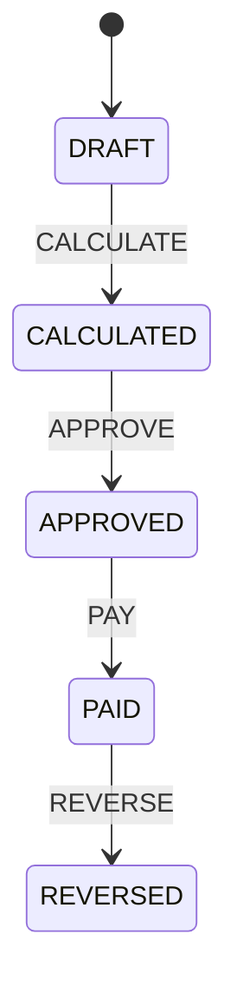

English | [简体中文](payrun-states.zh-CN.md)

# Pay-run state transitions and net-pay test boundaries

Olivia Brooks — 2026-05-22

## State transitions

| State | Accepted event | Next state | Other events |
| --- | --- | --- | --- |
| DRAFT | CALCULATE | CALCULATED | reject, no change |
| CALCULATED | APPROVE | APPROVED | reject, no change |
| APPROVED | PAY | PAID | reject, no change |
| PAID | REVERSE | REVERSED | reject, no change |
| REVERSED | none | — | reject, no change |

`PayRunStateTest` checks all four arrows and all 16 rejected state/event pairs. It reaches each starting state through public operations on a fresh `PayRun`. Every rejected pair must throw `IllegalStateException` and leave both `state` and `approvalCount` unchanged. `REVERSED` accepts no further event.

The initial implementation had a sneak path outside the transition table: a second `APPROVE` while already `APPROVED` incremented `approvalCount` and returned successfully. The state stayed `APPROVED`, so checking state alone would miss the extra approval. The rejected-pair test failed on that call. The fix removes the special case and sends every event through the transition table, rejecting invalid pairs before changing either field. Duplicate payment authorization is the business risk; this in-memory object does not itself send a payment.

## What the withholding double could not show

`NetPay` accepts an injected `Withholding`. In `NetPayTest`, a Mockito mock returns `0.00` for any `BigDecimal` argument. The test calls the real `NetPay` with real employee pay implementations and checks the resulting amount and its two-decimal scale. This checks adjustment arithmetic when nothing is withheld, but cannot distinguish withholding on the original gross from withholding on the adjusted gross: either argument produces the same zero tax, and the test does not inspect that argument.

The first implementation called `withholding(gross)` before adding the adjustment. Even the salary-correction case passed with the mock: $650.00 minus $200.00 minus zero is $450.00.

`NetPayScheduleTest.salaryCorrectionUsesAdjustedGrossForWithholding` exposed the error using `new NetPay()`, whose default constructor supplies `new LegacyPayEngine()::withholding`. The example weekly schedule is synthetic, not an official tax table. The test explicitly checks that withholding on $650.00 is $15.00 and withholding on $450.00 is $0.00. With a $650.00 weekly salary, 38 hours and a −$200.00 correction, the old calculation returned $435.00 ($650.00 − $200.00 − $15.00); the expected net is $450.00.

The real-schedule tests cover these amounts, all with that $650.00 salary and 38 hours:

| Test | Adjustment | Adjusted gross | Expected net |
| --- | --- | --- | --- |
| `salaryCorrectionUsesAdjustedGrossForWithholding` | −$200.00 | $450.00 | $450.00 |
| `correctionEqualToGrossWithholdsNothing` | −$650.00 | $0.00 | $0.00 |
| `correctionExceedingGrossWithholdsNothing` | −$700.00 | −$50.00 | −$50.00 |
| `bonusIsIncludedInTaxableGross` | +$100.00 | $750.00 | $725.00 |

The three correction tests exposed the original calculation; the bonus test accompanies the fix. `NetPay.net` now adds the adjustment to `pay.gross(hours)` first. It calls `Withholding` with that adjusted gross only when it is positive; otherwise it withholds zero without calling the collaborator. It subtracts tax and rounds the net to two decimal places with `HALF_EVEN`. An excess correction therefore remains a negative net; it is not clamped to zero. Separately, `LegacyPayEngine.withholding` rejects negative gross with `IllegalArgumentException` and `Invalid gross for tax schedule`; `negativeGrossIsRejectedByTaxSchedule` checks −$0.01. `zeroGrossHasNoWithholding` checks that zero gross returns zero tax.

## Choosing the test boundary

A double remains useful at the `Withholding` boundary when testing `NetPay` arithmetic under a controlled tax response. To check which amount is passed, a test can verify the argument or use a response that depends on it; the existing zero-returning test does neither. Keep the real-schedule tests to check the calculation against the actual collaborator.

The state tests use the real `PayRun` because its state is the behavior under test. A mock would only reproduce its setup and could conceal the approval-count mutation. Likewise, `SalariedPayTest`, `HourlyPayTest` and `CasualPayTest` inherit `EmployeePayContractTest` and supply real implementations. The shared tests check nonnegative gross with two decimal places at eight hours and rejection of negative hours. They do not establish each subtype's exact pay formula; those amounts need separate assertions.
