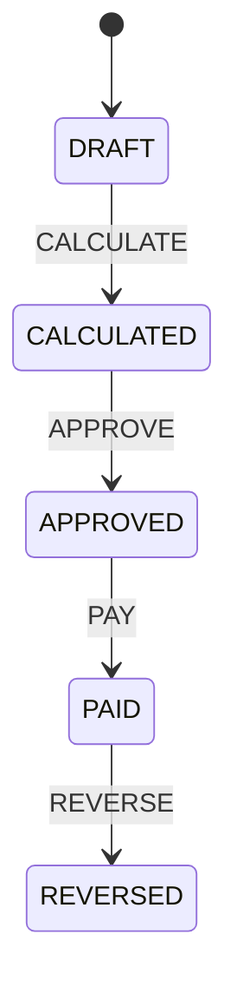

[English](payrun-states.md) | 简体中文

# 工资批次状态迁移与实发工资的测试边界

Olivia Brooks — 2026-05-22

## 状态迁移

| 状态 | 接受的事件 | 下一状态 | 其他事件 |
| --- | --- | --- | --- |
| DRAFT | CALCULATE | CALCULATED | 拒绝且不变 |
| CALCULATED | APPROVE | APPROVED | 拒绝且不变 |
| APPROVED | PAY | PAID | 拒绝且不变 |
| PAID | REVERSE | REVERSED | 拒绝且不变 |
| REVERSED | 无 | — | 拒绝且不变 |

`PayRunStateTest` 覆盖四条有效迁移和 16 个无效状态／事件组合。测试为每个拒绝组合新建 `PayRun`，通过公开操作将它带到指定的起始状态。每个无效组合都必须抛出 `IllegalStateException`，并保持 `state` 和 `approvalCount` 不变。`REVERSED` 不再接受任何事件。

最初的实现有一条绕过迁移表的路径：已处于 `APPROVED` 时，第二次 `APPROVE` 会增加 `approvalCount`，然后正常返回。状态仍是 `APPROVED`，只检查状态就会漏掉多出的一次批准。拒绝组合测试在这次调用上失败。修复删除了这个特例，让所有事件都经由迁移表处理，在修改任一字段之前拒绝无效组合。业务风险是重复付款授权；这个内存对象本身并不发送付款。

## 计税替身没能说明什么

`NetPay` 允许注入 `Withholding`。`NetPayTest` 中的 Mockito mock 对任意 `BigDecimal` 参数都返回 `0.00`。测试使用真实的 `NetPay` 和员工工资实现，检查结果金额及其两位小数。这能检查不扣税时的调整金额运算，却无法区分计税依据是原始总工资还是调整后的总工资：传入哪一个，税额都是零，而且测试没有检查调用参数。

最初的实现先调用 `withholding(gross)`，再加上调整金额。即使是工资更正用例，使用这个 mock 也会通过：$650.00 减去 $200.00，再减去零，结果就是 $450.00。

`NetPayScheduleTest.salaryCorrectionUsesAdjustedGrossForWithholding` 使用 `new NetPay()` 暴露了错误；默认构造函数传入的是 `new LegacyPayEngine()::withholding`。这里的周预扣税表只是合成示例，并非官方税表。测试明确断言：$650.00 对应 $15.00 税额，$450.00 对应 $0.00 税额。周薪为 $650.00、工时为 38、调整金额为 −$200.00 时，旧算法得到 $435.00（$650.00 − $200.00 − $15.00），预期实发金额则是 $450.00。

使用真实税表的测试覆盖以下金额，均采用 $650.00 周薪和 38 小时：

| 测试 | 调整金额 | 调整后总工资 | 预期实发金额 |
| --- | --- | --- | --- |
| `salaryCorrectionUsesAdjustedGrossForWithholding` | −$200.00 | $450.00 | $450.00 |
| `correctionEqualToGrossWithholdsNothing` | −$650.00 | $0.00 | $0.00 |
| `correctionExceedingGrossWithholdsNothing` | −$700.00 | −$50.00 | −$50.00 |
| `bonusIsIncludedInTaxableGross` | +$100.00 | $750.00 | $725.00 |

三个更正测试暴露了原算法的问题；奖金测试随修复一起加入。现在，`NetPay.net` 先将调整金额加到 `pay.gross(hours)` 上。只有调整后总工资为正时，才将它传给 `Withholding`；否则税额为零，不调用计税协作者。扣除税额后，用 `HALF_EVEN` 将实发金额舍入到两位小数。因此，更正金额超过原工资时，实发金额保留负值，不会被改成零。另外，`LegacyPayEngine.withholding` 对负总工资抛出 `IllegalArgumentException`，消息为 `Invalid gross for tax schedule`；`negativeGrossIsRejectedByTaxSchedule` 用 −$0.01 检查这一点。`zeroGrossHasNoWithholding` 检查总工资为零时税额也为零。

## 如何选择测试边界

需要固定税额响应、单独检查 `NetPay` 的金额运算时，在 `Withholding` 边界使用替身仍然合适。要检查传入的金额，可以验证调用参数，或让替身根据参数返回不同结果；现有的零返回值测试没有做这两件事。仍须保留使用真实税表的测试，检查计算逻辑与实际协作者配合时的结果。

状态测试使用真实 `PayRun`，因为它的状态就是被测行为。mock 只会按预设响应，可能遮住批准次数的变化。同样，`SalariedPayTest`、`HourlyPayTest` 和 `CasualPayTest` 都继承 `EmployeePayContractTest`，并提供真实实现。共享测试检查八小时的总工资非负且保留两位小数，以及负工时会被拒绝。这些检查不能证明各子类型的具体工资公式正确；精确金额仍需单独断言。
